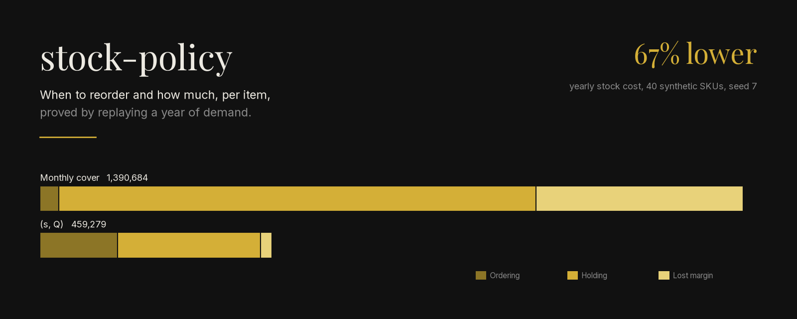
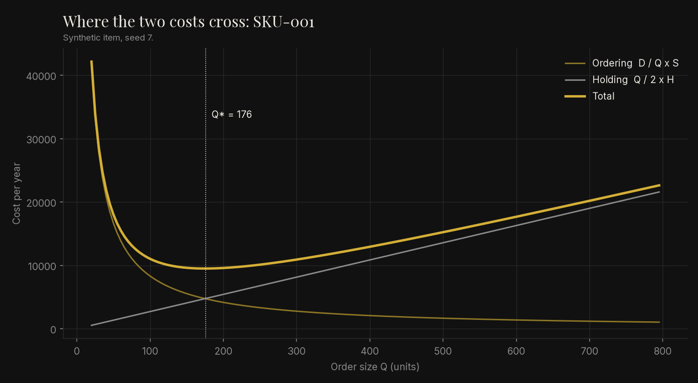
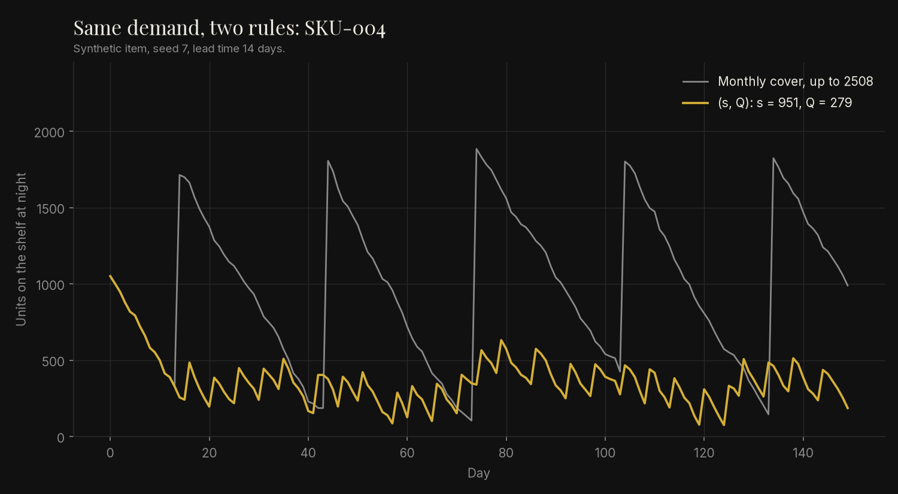

<p align="center">
  
</p>

<p align="center"><em>Synthetic data: 40 invented SKUs, seeded demand (seed 7). Not figures from any company.</em></p>

Sets, for each stocked item, when to reorder and how much, then replays a year of daily
demand to show what the policy costs against the usual "order a month of cover" rule.

## Problem

Many buyers reorder every item on the same calendar: once a month, enough to cover the
month plus the lead time. Expensive slow items then sit on the shelf for weeks, while
fast items with long or noisy lead times still run out. Nobody can say what either
mistake costs.

## Method

- **How much**: economic order quantity, Q = sqrt(2 D S / H).
- **When**: reorder point, s = m L + z sigma sqrt(L), for a 95% cycle service level.
- **Kanban** card count and a **newsvendor** quantity for one-shot seasonal buys are in
  the same module (`policy.py`) for lines that pull or buy once.
- **Replay** (`simulate.py`): each day receive, serve, review, pay holding. Unserved
  demand is lost and costs the margin. Stock is rebuilt from an append-only ledger, so the
  same moves always give the same balance.
- Money is `Decimal`, rounded half-up to cents. Derivations and hand cases are in
  [docs/derivation.md](docs/derivation.md).

## How to run

```bash
pip install -e ".[dev,figures]"
ruff check . && mypy && pytest            # fails below 100% coverage
python -m stock_policy --items 40 --seed 7
PYTHONPATH=src python scripts/make_figures.py
```

## Result

Default run, 40 synthetic SKUs, 365 days, seed 7, holding rate 25% a year (asserted in
`tests/test_catalog_compare.py`):

| | Monthly cover | (s, Q) per item |
|---|---:|---:|
| Ordering | 37,870.00 | 153,380.00 |
| Holding | 943,736.76 | 283,211.58 |
| Lost margin | 409,077.00 | 22,687.54 |
| **Total** | **1,390,683.76** | **459,279.12** |
| Fill rate (units) | 98.7% | 99.9% |
| Mean stock turnover per SKU | 22.6 | 68.6 |

The (s, Q) rule places about 4.6 times as many orders, and that is the point: on these
items an order is cheap next to a month of stock. Most of the saving is holding cost; the
rest is lost sales on fast items with long lead times.


*Synthetic item SKU-001, seed 7.*


*Synthetic item SKU-004, seed 7: same demand, the monthly rule peaks at 1,885 units, the
(s, Q) rule stays between 76 and 632 after the first drawdown.*

## Limits

- Demand is synthetic, normal and stationary; no seasonality, trends or promotions.
- Lead time is fixed. Variable lead time would need a larger safety stock.
- Ordering cost per order (40 to 120) is an assumption and drives the result. If placing
  an order really costs much more, the gap shrinks; rerun with your own costs.
- Lost sales are valued at the unit margin only; no customer loss, no backorders.
- No minimum order quantities, price breaks, shelf space or truck size limits.
- The monthly-cover baseline has no safety stock. A baseline with one would lose less
  margin and hold even more stock.
